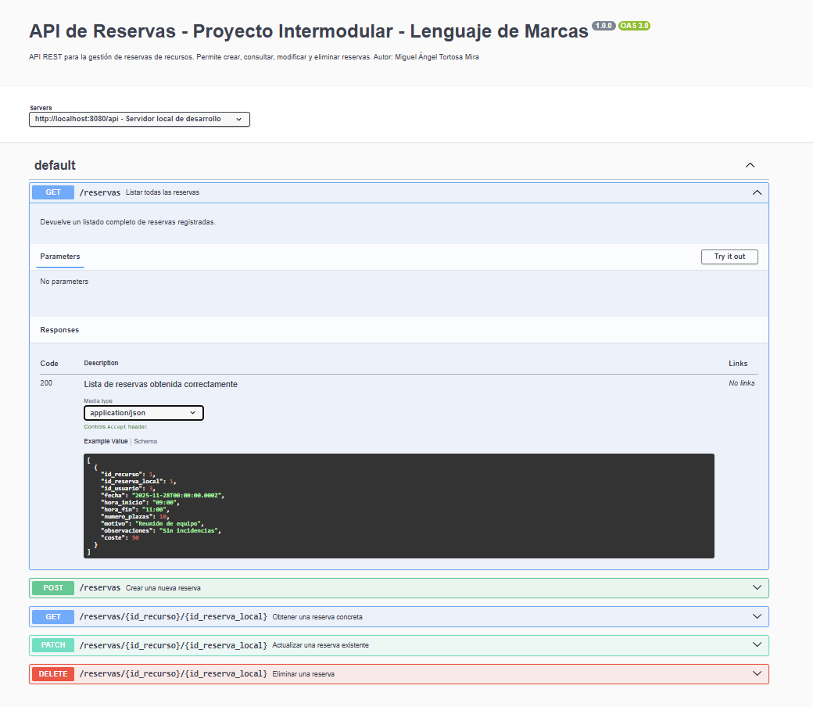

# Análisis de Dominio - Sistema de Reservas
**Proyecto Intermodular - Lenguaje de Marcas -  Miguel Ángel Tortosa Mira**

---

## 1. Introducción
El objetivo de este documento es analizar qué información de mi base de datos debe exponerse a través de la API REST para permitir las operaciones CRUD del sistema de reservas.  
La API actuará como contrato entre el frontend y el backend, permitiendo gestionar reservas de recursos realizadas por usuarios normales.

Aunque mi base de datos contiene varias tablas (`USUARIO`, `ADMINISTRADOR`, `USUARIONORMAL`, `RECURSO`, `HORARIO`, `DISPONIBLEEN` y `RESERVA`),solo expondré las necesarias para el CRUD de reservas siguiendo la recomendación de MVP indicada en el enunciado.

---

## 2. Tablas relevantes para la API

### 2.1. USUARIONORMAL
Representa a los usuarios que pueden realizar reservas.

**Campos en la BBDD:**
- `id_usuario` (PK, INT)
- `direccion` (VARCHAR)
- `telefono_movil` (VARCHAR)
- `fotografia` (VARCHAR)

**Campos que expondré en la API:**
- `id_usuario`
- `telefono_movil`
- `direccion` (opcional)

**Campos que NO expondré:**
- `fotografia`  No es relevante para el CRUD de reservas.

**Motivo:**  
El frontend solo necesita identificar al usuario que hace la reserva. No es necesario exponer datos sensibles o irrelevantes.

---

### 2.2. RECURSO
Es el elemento que se puede reservar.

**Campos en la BBDD:**
- `id_recurso` (PK)
- `nombre`
- `descripcion`
- `ubicacion`
- `capacidad`

**Campos que expondré en la API:**
- `id_recurso`
- `nombre`
- `ubicacion`
- `capacidad`

**Campos que NO expondré:**
- `descripcion`  No es necesaria para el CRUD básico.

**Motivo:**  
El frontend necesita mostrar una lista de recursos disponibles y sus datos principales.

---

### 2.3. RESERVA (entidad principal)
Es la tabla central del sistema.

**Campos en la BBDD:**
- `id_recurso` (FK)
- `id_reserva_local` (PK compuesto)
- `id_usuario` (FK)
- `fecha` (DATE)
- `hora_inicio` (TIME)
- `hora_fin` (TIME)
- `coste` (DECIMAL)
- `numero_plazas` (INT)
- `motivo` (TEXT)
- `observaciones` (TEXT)

**Campos que expondré en la API:**
- `id_recurso`
- `id_reserva_local`
- `id_usuario`
- `fecha`
- `hora_inicio`
- `hora_fin`
- `numero_plazas`
- `motivo`
- `observaciones`
- `coste` *(opcional)*


**Motivo:**  
El frontend necesita crear, listar, consultar y modificar reservas.  
Se usa clave compuesta (`id_recurso`, `id_reserva_local`) porque en la base de datos es PK compuesta.

---

## 3. Reglas de negocio y validaciones

### Validaciones de fecha y hora
- `fecha` debe ser igual o posterior al día actual.
- `hora_fin` debe ser mayor que `hora_inicio`.
- No debe haber solapamientos para el mismo recurso.

### Validaciones de usuario
- `id_usuario` debe existir en `USUARIONORMAL`.
- El usuario solo puede gestionar sus propias reservas (si se implementa en backend).

### Validaciones de recurso
- `id_recurso` debe existir en `RECURSO`.
- El recurso debe estar disponible en ese horario (si se implementa).

### Validaciones de campos numéricos
- `numero_plazas` > 0
- `coste` ≥ 0

---

## 4. Campos generados automáticamente
- `id_reserva_local`  Se genera por recurso.
- No hay timestamps automáticos en esta tabla.

---

## 5. Datos que viajarán en JSON

### Ejemplo de JSON de entrada (crear reserva)

```json
{
  "id_usuario": 3,
  "id_recurso": 1,
  "fecha": "2025-11-28",
  "hora_inicio": "09:00",
  "hora_fin": "11:00",
  "numero_plazas": 10,
  "motivo": "Reunión de equipo",
  "observaciones": "Sin incidencias"
}
```

### Ejemplo de JSON de salida (reserva creada)

```json
{
  "id_recurso": 1,
  "id_reserva_local": 1,
  "id_usuario": 3,
  "fecha": "2025-11-28",
  "hora_inicio": "09:00",
  "hora_fin": "11:00",
  "numero_plazas": 10,
  "motivo": "Reunión de equipo",
  "observaciones": "Sin incidencias",
  "coste": 50.00
}
```

---

## Validación de la especificación OpenAPI

A continuación se muestra la documentación generada correctamente mediante Swagger UI:




